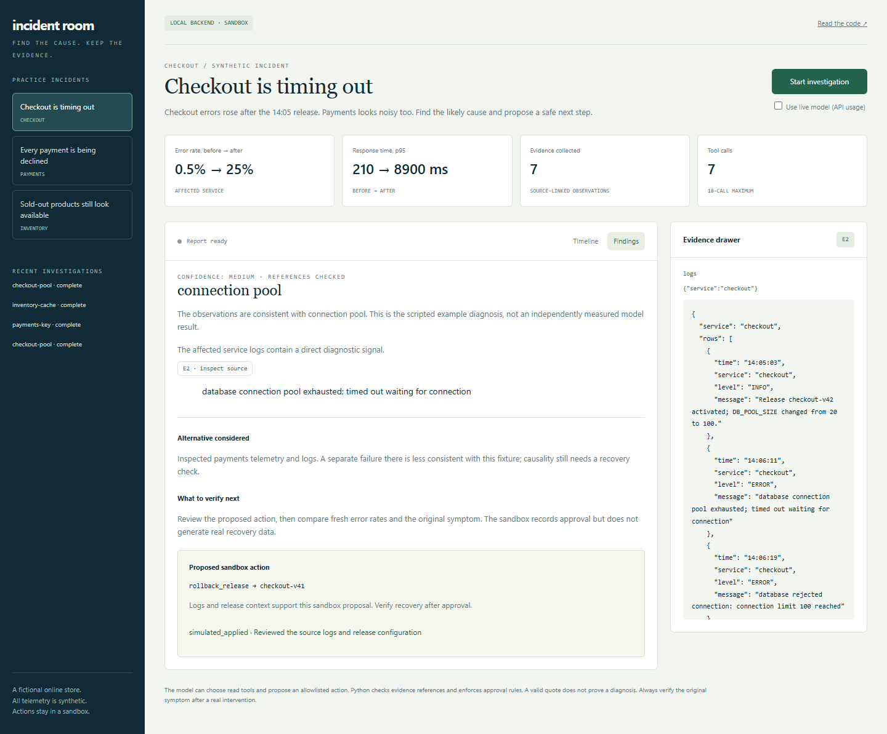

I build Python services for AI applications at Capital One. These are my independent projects.

[Portfolio](https://charanneelam123-dot.github.io/) · [LinkedIn](https://www.linkedin.com/in/charanneelam/) · [All repositories](https://github.com/charanneelam123-dot?tab=repositories)

## Inside two agent workflows

<table>
<tr>
<td width="50%" valign="top"><h3>Incident Room</h3>
Follow a simulated outage from the first log entry to the operator’s approval. Each finding links back to its evidence.
<a href="https://github.com/charanneelam123-dot/incident-room">Explore the investigation →</a></td>
<td width="50%" valign="top"><h3>Agent workflow platform</h3>
Run a LangGraph workflow, pause it for review, and see what happens when the same decision arrives twice.
<a href="https://enterprise-agentic-platform-s0cj.onrender.com">Try the live demo →</a></td>
</tr>
</table>

## Can the model cite its answer?

I compared two prompts on 40 synthetic cases with Llama 3.2. Both answered 35 correctly. When I also required the right citation, the baseline passed 17 cases and the longer prompt passed 10. [Inspect the 80 responses and scoring rules →](https://github.com/charanneelam123-dot/llm-evaluation-mlops/tree/main/docs/real-model-evaluation)

[Financial document search](https://github.com/charanneelam123-dot/financial-document-intelligence) · [Agreement comparison](https://github.com/charanneelam123-dot/what-changed) · [Fraud scoring](https://github.com/charanneelam123-dot/realtime-fraud-detection)
