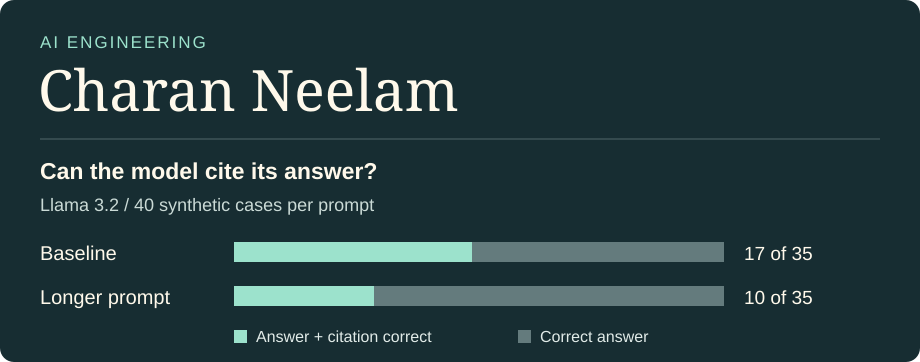

I build Python services for AI applications at Capital One. My independent work explores two questions I run into when building agents. When should a tool call pause for human review? How do you tell whether a model cited the right evidence?

[Portfolio and demos](https://charanneelam123-dot.github.io/) · [LinkedIn](https://www.linkedin.com/in/charanneelam/)

## Selected work

**[Incident Room](https://github.com/charanneelam123-dot/incident-room)**  
An incident investigation tool for simulated outages. Follow an investigation through logs, telemetry, and runbooks, then review the evidence before approving a sandbox action.

**[Agent workflows with LangGraph](https://github.com/charanneelam123-dot/enterprise-agentic-platform)**  
Ten workflows save progress and pause for review. Try approving the same request twice to see how the service handles duplicate decisions. [Open the demo](https://enterprise-agentic-platform-s0cj.onrender.com)

**[Evaluating citations with Llama 3.2](https://github.com/charanneelam123-dot/llm-evaluation-mlops/tree/main/docs/real-model-evaluation)**  
I tested two prompts on 40 synthetic cases using Ollama. Both passed the answer check on 35 cases. Requiring a correct citation dropped the baseline to 17 passes and the longer prompt to 10. The repository includes all 80 responses and the scoring rules.

## More projects

[Financial document search](https://github.com/charanneelam123-dot/financial-document-intelligence) · [Agreement comparison](https://github.com/charanneelam123-dot/what-changed) · [Fraud scoring](https://github.com/charanneelam123-dot/realtime-fraud-detection) · [Kafka and Spark pipelines](https://github.com/charanneelam123-dot/realtime-kafka-spark-streaming)
